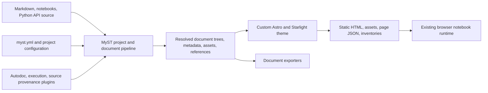

# Documentation pipeline options

The most useful boundary is MyST's document engine feeding a shared loader and
renderer, with Astro producing the website. Start with consumer-owned Astro
configuration; keep the MyST static-theme hook as another entry point over the
same rendering API. The main gain is one shared document pipeline for project
structure, references, computed content, and exports, while preserving consumer
control of site components. The branch's theme establishes the static boundary,
but is not yet a replacement for the existing Astro integration.

The execution comparison answers only which component computes Python results.
It does not establish configuration, rendering, development, or distribution
parity. Those determine whether this architecture is usable as a product.

## Concrete failures beyond execution

The [pipeline probes](pipeline-probes.mjs) were rerun against the checkout's
pinned MyST 1.11.0 on 2026-10-13. Their [results](pipeline-results.json) distinguish
engine output from our HTML adapter. They run real MyST builds and Word exports,
and use the existing package renderer as the comparison for authored content.

| Probe | What works | What fails | Responsibility |
| --- | --- | --- | --- |
| External MyST reference | The engine resolves a target served by another project and supplies its remote base URL | Our theme renders `/#shared-target`, pointing at the local site | Theme URL conversion |
| Tabs | The current package renders accessible tabs; MyST produces `tabSet` and `tabItem` nodes | The theme rejects `tabSet`; the Word export contains only the document title, omitting panel text | Theme coverage and, independently, MyST's Word exporter |
| Citations | The current package renders the bibliography; MyST processes the citation and exports its citation/bibliography to Word | The theme rejects `citeGroup` | Theme coverage and citation-context mapping |
| Grouped table of contents | MyST's manifest supplies a section entry and child-page levels | The theme requires every entry to have a page slug and rejects the group | Theme navigation mapping |
| Filtered include | The current package accepts the include; MyST processes it without the provenance plugin | Enabling our provenance plugin rejects the same source | Provenance integration |

These are observed failures, not a claim that MyST cannot support the missing
HTML behavior. In particular, the broken external link is a correctness bug in
[content.mjs](theme/content.mjs), rather than a limitation of MyST's resolver.
The tab export demonstrates why a successful export command alone cannot prove
that an output preserves content. The probe now extracts Word text through XML
parsing rather than searching the raw XML.

## Consumer-owned Astro experiment

The [hybrid probe](hybrid-probe.mjs) also passed on 2026-10-13. It creates a
consumer outside the checkout, installs the existing package archive plus pinned
Astro/Starlight dependencies, runs the MyST document build, then invokes Astro
directly. MyST's `build.render` hook is not used to launch the HTML build.

The [results](hybrid-results.json) confirm the consumer's own site title, custom
Astro banner component, and grouped sidebar. They also confirm rendered Python
output and inline results, output reuse on another page, API prose, source
markers, reference links under `/manual/`, and browser runtime/environment assets
with the matching prefix.

The first setup used dependency symlinks, which exposed Astro's CSS compilation
assumptions when dependency files resolve outside the consumer root. Installing
the archive and dependencies into the actual consumer resolved that problem.
The loader/plugins still import this checkout, and the public browser build
cache is copied to avoid another environment download. This is an installed
package experiment, not yet an independently distributed JSON loader/theme.
It does not check reader kernel execution, automatic reload, or publication of
the external-reference files. Those remain validation gates.

## The proposed ownership



MyST manages the document graph and the transformations that give documents
their meaning. The theme renders that meaning and supplies navigation, layout,
search UI, reference previews, and browser controls. Plugins generate or annotate
document content. The browser runtime starts a separate reader session; choosing
a build-time executor does not choose its controls or Python environment.

This is already the branch's architecture for static builds. Calling it a MyST
theme means it implements the `template.yml` / `build.render` contract and
consumes engine output. It does not imply a React renderer, an upstream book
theme, complete MyST feature coverage, or a packaged installation. MyST's
[theme contract](https://mystmd.org/guide/theme-developer) also describes the
separate development-server, option-validation, and distribution interfaces.

## Comparison across the pipeline

| Area | Existing Astro driver | MyST driver with our custom theme |
| --- | --- | --- |
| Project structure and routes | Astro collections and our route manifest; sidebar and page policy use Astro/Starlight configuration | MyST owns the project and TOC; the theme must translate navigation and routes without discarding groups or prefixes |
| Parsing, includes, numbering, citations, references | We compose MyST libraries and supply project-level orchestration ourselves | MyST runs its own project pipeline; the theme receives processed documents |
| Project maintenance | `resolveDocument()` prepares the registered collection for each requested page; we maintain manifest updates and resolution rules | Those responsibilities can move to the driver; this removes duplicated project orchestration, though no book-scale speedup has been measured |
| Python API content | Pydocs/Griffe integration with Astro collections, components, and API page generation | Standalone Griffe plugin generates portable document nodes on authored pages; automatic API page trees and several class-doc conventions remain missing |
| External API references | Package inventory reader and combined publication inventory | MyST handles ordinary project references; typed Python references still use the isolated Sphinx reader and post-build inventory augmentation |
| Document exports and output reuse | Primarily an HTML pipeline; computed-cell embeds are explicitly rejected by our document resolver | Computed results can be shared across pages and exporters; each format still needs semantic checks, as the tab Word export shows |
| Rich HTML | Existing handlers for citations, tabs, cards, diagrams, footnotes, and other authored constructs | Engine support does not automatically enable theme support; the experimental allowlist and context mapping are narrower |
| Source provenance | Existing mapping includes authored Markdown and notebook-to-MyST source handling | Exact Markdown and unfiltered-include selections work in the fixture; notebook prose and filtered includes are incomplete |
| Reader execution | Existing activation, editable cells, hidden setup, rerun, restart, environment/wheel/mount configuration | The same runtime works; consumer environment, wheel, mount, and presentation options are not yet exposed by the theme |
| Development | Astro dev and collection watcher integration; Python library/environment edits still require restart | Only static builds are implemented; MyST content reloads must be bridged into Astro, and Python dependencies and typed inventories need explicit refresh policy |
| Installation and configuration | Tested initializer, compiled npm archive, Pixi tasks, and consumer configuration | Checkout-local imports and a hard-coded docs browser environment; no standalone theme bundle or equivalent initializer |
| Deployment | Existing Astro output and base handling | Static HTML needs no production server; the theme also owns copying assets, published page JSON, and inventory files |

The maintenance gain comes from retiring our project-processing work, not from
changing frontends. [src/documents.mjs](../../src/documents.mjs) currently loads
and prepares all registered documents during a page-resolution call, then
implements include rebasing, bibliography handling, embeds, route translation,
and ambiguity checks. [src/source-loader.ts](../../src/source-loader.ts) keeps
the Astro route manifest current. A MyST-driven theme can reuse engine results
instead. Keeping both resolvers active in one build would erase much of that gain.

Some presentation work can be shared immediately in principle: the existing
`mystRehype` handlers already render many constructs. However, they expect the
form of nodes produced by our current document processing. The driver supplies
different citation/reference context, so extending an allowlist alone is not a
complete adaptation.

## Configuration, plugins, and interoperability

There are two configuration gaps. Theme settings belong in the theme's declared
options and the configuration received from MyST. The prototype currently passes
only page titles into the Starlight collection and builds a flat sidebar; it
does not map the consumer's full branding, page metadata, or runtime settings.
That is implementation work on a documented theme interface.

Document plugins have a different problem: the public transform used here
receives a tree and VFile, without the resolved page/project execution settings.
The execution prototype rereads local frontmatter and rejects inherited config.
Expanding that workaround into a second MyST configuration resolver would defeat
the architectural aim. Custom settings are nevertheless possible now: Python,
timeout, and default skip policy can be passed to `createDocumentExecution()`;
theme options can be declared in `template.yml` and configured through
`site.options`. The gap is access to MyST's processed built-in page settings,
not an inability to configure plugins or themes.

The co-review narrowed this further for MyST 1.11. `execute` and `kernelspec` are
page-only keys, not project settings; execution does not inherit through the
project fallback list. Rejecting all `extends` configuration is therefore a
prototype restriction broader than execution requires. Valid page settings still
need a contract: the plugin does not normalize deprecated `skip_execution`, does
not implement `execute.cache` / `execute.depends_on_env`, and uses its configured
Python rather than selecting by `kernelspec.name`. MyST's output-filter settings
are applied by the engine after the document transform, so those are not lost.
Before migration, either expose processed page settings upstream or validate and
document the subset the plugin honors, with explicit handling of aliases and
unsupported options.

The standalone autodoc package is a stronger boundary. Its temporary Python
object/reference nodes are lowered to ordinary MyST nodes before project
resolution. This makes generated content usable outside our theme. Custom nodes
help extraction and transformation, but do not by themselves provide Sphinx's
Python domain types. Typed `py:function`, `py:class`, and related inventory entries
still require the post-build augmentation. The separate inventory consumer
preserves Python case and checks the referenced object's kind.

The packed-plugin checks passed eight tests on 2026-10-13, including independent
Sphinx 9 and plain MyST consumers, aliases, URL prefixes, external Sphinx links,
and strict reference failures. Those checks establish plugin/inventory behavior;
they do not validate our theme's HTML rendering of every external reference. The
new cross-project HTML probe exposes exactly that remaining distinction.

## Alternatives

**Keep Astro as the driver.** This offers the most complete existing consumer
workflow and direct Astro customization. It is reasonable for a site containing
substantial application pages. Its cost is maintaining our own project-level
use of MyST libraries, with less direct access to the engine's document exports
and computed-content reuse. Choose this if the theme/development contract proves
too restrictive for the intended consumers.

**Use MyST with the custom static theme and separate plugins.** This retains the
working reader experience while giving project/document processing to MyST.
The static build and notebook boundary have been exercised end to end. It remains
a useful entry point for consumers who want MyST to launch the whole build,
conditional on fixing the confirmed renderer gaps and demonstrating
configuration, development, and installation in a fresh consumer.

**Use MyST with an upstream book theme and the plugins.** This could reduce the
amount of document rendering and frontend UI we maintain. It does not
automatically integrate our editable notebook controls, runtime assets, or source
selection behavior. The reusable browser components could be adapted, but that
integration has not been tested here. It deserves a small consumer experiment
before concluding that retaining Astro is cheaper. The current checks of
`book-theme` projects verify content/plugin interoperability, not an upstream
theme's complete HTML/browser behavior.

**Prebuild MyST content, then run a separate Astro build.** This uses the same
resolved-document boundary as the theme, so it can preserve more consumer control
over Astro configuration. It adds orchestration for build order, asset copying,
watch/reload, and publishing inventories. The installed-consumer static experiment
passed; the development and complete publishing workflow remains untested.
This is the preferred initial consumer entry point. It does not remove the
renderer/configuration gaps, and should share its implementation with the theme.

Jupyter Book 2 is a distribution/CLI wrapper around the MyST engine, rather than
a separate solution to these integration gaps. Its
[FAQ](https://jupyterbook.org/latest/resources/faq/) describes the shared
commands, configuration, and plugin system. Using it can change installation
convenience, but does not supply the missing theme adapters or typed API domain.

## Independent co-review

The user requested a parallel Claude Opus review. Its
[full assessment and subsequent corrections](claude-pipeline-review.md) are
saved here. The reviewer independently ran the pipeline probes, extracted Word
text, and inspected the engine's resolved trees and configuration API.

The central disagreement was whether MyST should be the consumer's mandatory
site driver. The co-review favored keeping Astro as the consumer entry point;
the new consumer experiment provides concrete support for that distinction.
Both assessments support replacing our document orchestration with the MyST
engine and treating the present HTML/navigation failures as adapter work.

Two points from the initial co-review needed correction. Project-level execution
keys are invalid in MyST 1.11, so ignoring them is not a plugin divergence.
`filterIncludedContent` is not exported through `myst-transforms`' public package
entry. A public include-transform callback may recover contiguous selected text
and its starting line, but that adapter remains untested; noncontiguous selections
need a line map or an explicit failure policy. Our current mapper rejects those
noncontiguous selections too.

The review also identified contracts worth testing before packaging: plugin
ordering and shared metadata (`astroNotebookTags`, `autodocGenerated`, origins),
the unhandled `skip_execution` alias, and output filename collisions between page
JSON and reference/config files. Standalone autodoc already works without the
other plugins; combining plugins should not turn their implicit conventions into
an undocumented consumer requirement.

## Decision and next experiments

Establish the shared engine-to-renderer contract before choosing a mandatory site
driver. Assess it by one complete consumer workflow rather than by another
executor test:

1. Extract the computed-document loader/renderer into a public package API usable
   from consumer-owned Astro configuration and the MyST theme hook. Require a
   working `myst build --site` followed by an Astro build before committing to the
   theme as the only entry point.
2. Render the existing authoring coverage from engine output, including remote
   references, citations, grouped navigation, tabs/cards/footnotes, and assets.
   Check actual links and exported content; keep unsupported constructs explicit.
3. Establish a consumer configuration contract for branding, page metadata,
   presentation, browser environments/wheels/mounts, API extraction, and execution
   policy. Demonstrate the policy chosen for inherited configuration.
4. Exercise content watch/reload in the consumer-owned Astro workflow, and
   implement `myst start` for the theme entry point with engine websocket events.
   Check Markdown/include/TOC edits, Python edits, and typed-inventory refresh
   separately; neither should be silently assumed to work.
5. Build a self-contained theme bundle and independently installable plugins.
   Replace checkout-relative imports and the docs environment with declared
   dependencies and consumer settings. Test a fresh project outside the repo,
   then the Pymablock consumer, including deployment under a URL prefix.
6. Run the same reader fixture with an upstream theme and the reusable browser
   components. Compare implementation effort, behavior, and configuration with
   the Astro candidate before deciding which frontend to maintain.

Executor choice remains replaceable within that pipeline. The existing nbclient
document plugin preserves the current safeguards, while the separate
[execution investigation](execution-options.md) records the native caching and
timeout tradeoffs. This assessment does not rerun those five execution variants
or claim that the experimental theme has been installed in Pymablock.

To repeat the pipeline probes after compiling the package:

```sh
pixi run npm run build
pixi run node experiments/myst-theme/pipeline-probes.mjs /tmp/pipeline-results.json
```

The probes leave temporary fixtures for inspection and emit no raw tool logs.

To repeat the installed-consumer experiment, first create the archive and the
theme's public browser-environment cache:

```sh
pixi run pack
pixi run npm run myst:build
pixi run node experiments/myst-theme/hybrid-probe.mjs /tmp/hybrid-results.json
```
